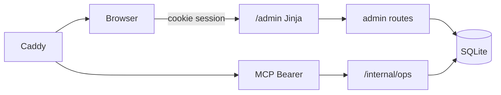

# Админка Поровну

## Вердикт по авторизации

**Keycloak не берём.** Для одного оператора, одного сервиса и SQLite это лишний контейнер, TLS-клиенты, realm/users, обновления и точки отказа. Уже есть SOPS + `OPS_TOKEN` — тот же контур секретов.

**Выбранный вариант:** один `ADMIN_PASSWORD` (SOPS) → форма логина → подписанная **HttpOnly**-cookie-сессия (Starlette `SessionMiddleware` / `itsdangerous`). Logout сбрасывает cookie. Без регистрации и ролей.

Не смешивать с `OPS_TOKEN`: MCP/ops остаются machine-to-machine; админка — browser session. Cookie только на пути `/admin`, `Secure` + `SameSite=Lax` за Caddy.

Альтернативы, которые сознательно отвергаем сейчас:

- Keycloak / OIDC — когда появятся несколько админов или SSO.
- HTTP Basic на Caddy — просто, но хуже UX и аудит сессий.
- Переиспользование `OPS_TOKEN` в браузере — токен утечёт в историю/логи форм.

## Архитектура

- UI: SSR Jinja в том же `web`-контейнере — как `/`, `/e`, `/r`.
- Префикс: `/admin/*`, не в публичном sitemap/`robots` (Disallow `/admin`).
- Логика статистики в `app/admin_stats.py`; write-операции — только в admin-роутере.
- Rate limit на `POST /admin/login` (slowapi).

## Опции админки (MVP → позже)

### MVP (`0.18.0`)

**Обязательная аналитика на дашборде:**

| Виджет | Правило |
|--------|---------|
| Топ-20 событий | По числу трат (`COUNT(expenses)`), tie-break: новее `created_at`. Поля: место, имя, slug, expense_count, created_at, ссылки `/e` `/r`. **Без сумм и имён плательщиков.** |
| Топ-20 назначений платежа | По `Expense.description` (нормализация: `trim` + `casefold` в Python — SQLite `lower()` не умеет кириллицу; в UI — самый частый оригинал). Поля: description, count. Пустые описания в топ не входят. |
| График созданий мероприятий | Число `Event` по `created_at` за интервал. Период: **7 / 30 / 90 / 365** дней (default **30**). Бакеты: по дням для 7/30/90, по неделям для 365. Рендер: **Chart.js** (CDN только на `/admin`). Пустые бакеты = 0. |

Остальное MVP:

| Раздел | Что умеет |
|--------|-----------|
| Логин / выход | пароль из SOPS, сессия |
| Дашборд | health, счётчики + топы и график |
| Список событий | пагинация, поиск по slug/имени |
| Карточка события | мета + флаг OG; без сумм и имён |
| Действия | удалить событие (+ OG); ручной cleanup |
| Smoke | public-checks |

### Не в MVP

- Просмотр сумм/плательщиков (PII).
- Топ по сумме ₽ / топ плательщиков.
- Редактирование трат; управление секретами/docker из UI.
- Grafana; мульти-админ / RBAC.

### Фаза 2

- PII по confirm + audit log.
- Топ по сумме; regenerate OG; CSV export; IP allowlist на `/admin*`.

## Секреты и деплой

- В `secrets.enc.yaml` (через sops): `ADMIN_PASSWORD`, `ADMIN_SESSION_SECRET` — добавить локально:
  `SOPS_AGE_KEY_FILE=keys/age-dev.key sops secrets.enc.yaml`
- `docker-compose.yml`: проброс в `web` (+ `ADMIN_COOKIE_SECURE=1` на проде).
- Пустой пароль / secret → `/admin` отдаёт **404**.
- Документация: [`docs/admin.md`](docs/admin.md).

## Принципы безопасности

- Write только с сессией; CSRF-токен в сессии на POST.
- Не светить секреты и expense PII в MVP.
- Structured log при login fail/success и delete event.
